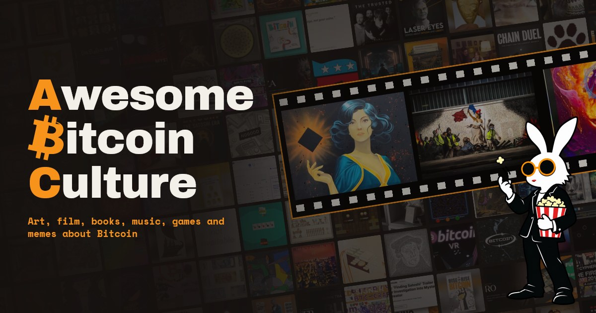
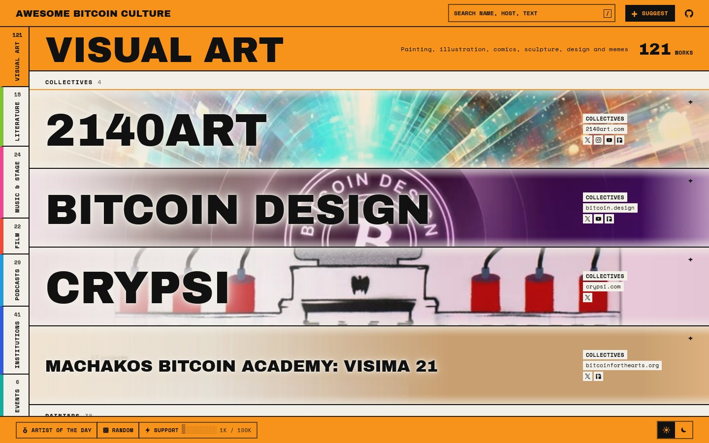

# Awesome Bitcoin Culture 

> A curated list of human creative work about Bitcoin - film, visual art, sculpture, literature,
> music, dance, games, and the places, archives, and events that gather this scene together.

[🖼️ Gallery](https://awesomebitcoinculture.com/) · [💡 Suggest an entry](https://awesomebitcoinculture.com/#suggest) · [⚡ Support](#support) · [🟣 Nostr](https://njump.me/npub1vj4fdx2299g6mq7keqlpnwu52lvpwsslfna8efee66hguv9qcl0qe5ufj0)

## 👋 Hello

Bitcoin has made a lot of art, films, books, music and games that have nothing to do with price charts.
This list gathers that work in one place, so it is easy to find and hard to forget. If you make
things, love things, or just wonder what Bitcoin culture looks like: welcome. Take a walk through it
and tell us what we missed. 🧡

Bitcoin has produced a real body of creative and cultural work, separate from its use as money
or its developer tooling. This list catalogs that work: the people who made it, where to see it,
and the institutions that support it. It is deliberately **not** another `awesome-bitcoin`
dev-tools/wallets/services list - those already exist and are well maintained elsewhere.

## 🟢 Where it stands

**Live and growing.** The list is public, curated by hand and updated as new work turns up. It has more than 300
entries in eight sections: Visual Art, Literature, Music & Performing Arts, Film & Documentary, Podcasts,
Institutions & Spaces, Events & Festivals and Games. The gallery website is rebuilt from this README on every
push, so what you read here is always what the site shows. The list is released under CC0.

## 🖼️ The gallery

Every entry is a banner with the work's own art (or a generated tile), a link to the work and, where we could verify them, the creator's social profiles.
Search by name, host or text, open the Artist of the day, hit Random, or use Suggest to send us something new.
There is also a plain-text [llms.txt](https://awesomebitcoinculture.com/llms.txt) copy of the whole list.

## 🧭 What belongs here

### Scope

Bitcoin as subject and inspiration for human creative work - film, literature, visual art,
sculpture, music, dance and stage, podcasts and other long-form media, and games - plus the archives,
spaces, institutions, and events that preserve and gather that work. A game counts when the game
itself is the work; earning or paying sats inside it is fine. Wagering & Casino is a small
subsection for Bitcoin-native games played for stakes, not a gambling directory. This is not a
directory of financial products, exchanges, or speculative collectible drops.

### Inclusion criteria

1. **Primary intent is creative, not financial.** A painting about Bitcoin qualifies. A PFP
   collection sold for profit doesn't, even if well-made, unless it clears #2.
2. **Attributable to a named human creator or identifiable studio/collective** - a consistent
   public pseudonym counts; an anonymous generative contract does not. (Meme art, filed under
   Digital & Graphic Artists, is the one deliberate exception: entries there don't need individual
   attribution, just to be a recognizable, lasting part of Bitcoin's internet culture.)
3. **Publicly viewable or verifiable.** The link must show or play the actual work.
4. **Someone can personally vouch for it.** Curation over comprehensiveness.
5. **Active or complete**, not an abandoned stub.

**AI-assisted work** is welcome when a named artist directs it and stands behind it as their own
practice; entries say when AI is part of the process. Bulk-generated output with no identifiable
author is not.

**Explicitly excluded:** NFT/ordinals PFP collections, exchange-marketing "art" campaigns, meme
coins, and bulk-generated AI output with no identifiable author.

**Disclosure:** the maintainer also runs Bitcoin FilmFest, Bitcoin Shipshow, Bitcoin District, and
Awesome Bitcoin Events, which are all listed here. They were held to the same criteria as every
other entry.

## 🤝 Join in

This list is only as good as the people who look at it. Every kind of help is welcome.

💡 **You know a creator or work we missed.** Use the Suggest button in the gallery, or [open the issue form](https://github.com/itstomekk/awesome-bitcoin-culture/issues/new?template=suggest-entry.yml). Include a link where the work can actually be seen.

🛠️ **You spotted a dead link or a wrong description.** Open a pull request that edits `README.md`. Keep to one short line per entry, in the section's existing order.

🎨 **You made something about Bitcoin.** Welcome. Send it in the same way. A named person, studio or consistent pseudonym is enough.

🤔 **You are not sure it fits.** Open an issue and ask before you do any work.

⚡ **You like it.** Tell a friend, tell an artist on the list, or use the Support link at the top.

The full rules are in [CONTRIBUTING.md](CONTRIBUTING.md). The list is curated by
[Tomek Kołodziejczuk](https://github.com/itstomekk), and every suggestion is read by a person.

## Contents

- [🎨 Visual Art](#-visual-art)
  - [Collectives](#collectives)
  - [Painters](#painters)
  - [Illustration & Digital Art](#illustration--digital-art)
  - [Comics & Picture Books](#comics--picture-books)
  - [Sculpture & Objects](#sculpture--objects)
  - [Mixed Media & Craft](#mixed-media--craft)
  - [Design & Merch](#design--merch)
- [📚 Literature](#-literature)
- [🎵 Music & Performing Arts](#-music--performing-arts)
- [🎬 Film & Documentary](#-film--documentary)
  - [Documentaries](#documentaries)
  - [Fiction](#fiction)
- [🎙️ Podcasts](#-podcasts)
  - [Art & Creators](#art--creators)
  - [Stories & People](#stories--people)
  - [Community & Places](#community--places)
  - [Ideas & Philosophy](#ideas--philosophy)
  - [Narrative Series](#narrative-series)
- [🏛 Institutions & Spaces](#-institutions--spaces)
  - [Galleries, Museums & Hubs](#galleries-museums--hubs)
  - [Archives & History](#archives--history)
  - [Community Spaces](#community-spaces)
  - [Grants, Funders & Patronage](#grants-funders--patronage)
  - [Publications & Media](#publications--media)
  - [Platforms & Marketplaces](#platforms--marketplaces)
- [🎪 Events & Festivals](#-events--festivals)
- [🎮 Games](#-games)

---

## 🎨 Visual Art

### Collectives

- [2140Art](https://2140art.com) - Online magazine and collective for Bitcoin-inspired art, music,
  and culture; runs a virtual gallery.
- [Bitcoin Design](https://bitcoin.design/) - Open community of designers making Bitcoin products
  easier to use; publishes the open-source Bitcoin Design Guide.
- [Crypsi](https://crypsi.com/) - Anonymous collective making hand-stencilled spray-paint canvases
  on Bitcoin themes since 2014.
- [Machakos Bitcoin Academy: Visima 21](https://www.bitcoinforthearts.org/artists/visima-21) - Planned
  trail of 21 murals in Machakos, Kenya, each painted by an artist the academy chooses; built with
  Bitcoin for the Arts and paid in stages as stations are finished (in progress).

### Painters

- [A13MW](https://www.a13mw.com/) - Painting, printmaking, and hand-drawn animation, anchored by
  "Buzzbee, the African Bitcoin Queen".
- [Alex Schaefer](https://www.saatchiart.com/paintwithalex) - Oil painting, expressionism; famous
  for the 2011 "banks on fire" series.
- [Amy DiGi](https://www.amydigi.com/bitcoin) - Oil paintings with symbolic Bitcoin imagery, such as
  "Genesis Slice" and "Bullish"; also hand-printed giclee prints.
- [April Popko](https://www.popkoproductions.com/bitcoin-art.html) - Abstract acrylic and gold-leaf
  paintings on Bitcoin themes, made in Prague.
- [Asanoha](https://sovereignremnant.com/) - Sacred-geometry and gold-leaf painting inspired by Japanese
  craft; also runs Timechain Art Magazine.
- [B](https://x.com/cryptbdango) - Airbrush-based physical art; featured in BTC Prague's
  Bitcoin-only gallery.
- [Bitcoin Apex](https://bitcoinapexart.com) - Pencil, Dürer-esque portraiture.
- [Blu3baer](https://timechainartmagazine.com/artist/blu3baer/) - Acrylic paintings and limited
  prints reworking figures from films, games, myths, and Bitcoin memes.
- [Cyber / Street Cyber](https://x.com/streetcyber_art) - Stencil art and paste-ups; "Born Debt-Free"
  series.
- [Flo Montoya](https://scarce.city/creators/flo-montoya) - Poster and wheatpaste, protest-art
  tradition.
- [Free Market Simpson](https://free-market-simpson.is/home/) - Polish painter: acrylic canvases, 3D
  lenticular and riso prints on free-market and crypto-anarchist themes.
- [Fzero](https://9fold.co/worlds/fzero) - Painting rooted in a tattooing background; "GENESIS 113"
  (2026) is a 100-hour canvas on consciousness and sovereignty; also
  creator of the animated series *$BLEEP*.
- [George Bodine](https://georgebodineart.com/) - Oil painting of landscapes, cityscapes, and
  figures, both plein air and in the studio.
- [Isolabellart](https://isolabellart.it.com/) - Oil painting inspired by light, silence, and place;
  each work is unique and offered exclusively for Bitcoin.
- [Jake Allen](https://www.artworkbyja.com/) - Acrylic paintings on canvas and custom-painted
  objects, including a Bitcoin guitar.
- [Johnny Dollar](https://johnnydollar.art/) - Post-pop surrealism, cypherpunk themes, pseudonymous.
  Represented by Bitcoin Art Gallery Wynwood.
- [Josie Bellini](https://josie.io/) - Paintings and editioned prints on Bitcoin themes, including
  "The People" (We Are Satoshi) and "Free Ross".
- [Jure Kastelic](https://www.whitecrypt.com/jure-kastelic) - Bitcoin-mythology painting; also works
  in sculpture and glass collaboration.
- [Kenneth Burris](https://kennethburris.com/data-becoming-form-series/) - Oil painting informed by
  landscapes and verified Bitcoin block data; BFTA Board Advisor.
  ([X/Twitter](https://x.com/KBStudioNYC))
- [Ksenia Buridanova](https://buridanova.com/) - Classical oil painting with magical realism and
  Bitcoin-era meme imagery on linen, canvas, and wood panel.
- [Lady Block Jane](https://www.ladyblockjane.com/bitcoin-art.html) - Swiss tattooist turned
  painter; Bitcoin paintings, posters, and temporary tattoos such as "Unbroken Chain".
- [Lisa Törner](https://www.lisat.se/crypto-art) - Stockholm acrylic paintings and limited prints
  built from financial-press imagery and monetary themes.
- [MEAR ONE](https://store.mearone.com/products/the-magician) - Painting and muralism, metaphysical surrealism;
  *The Magician* print for Bitcoin Magazine's 256-for-256 series.
- [Moon](https://moongoon.art/) - Painted maze compositions on mixed-media paper that tie making to
  proof of work.
- [mx12art](https://mx12.art/) - Painting and hand-painted wearable art linking proof of work to
  rebuilding identity after memory loss.
- [NAPLES](https://mnaples.com/) - Oil painter bringing contemporary realism and still life to
  Bitcoin culture.
- [Pascal Boyart (PBOY)](https://en.pboy-art.com/) - Paris muralist: monumental figurative murals,
  paintings, and prints with Bitcoin imagery.
- [Petek](https://www.petek.co.uk/) - Acrylic paintings and hand-modified prints with gold leaf,
  meteorite, Moon dust, and banknotes; painted "Genesis" for PlanB.
- [Proof of Paint](https://proofofpaint.art/) - Oil painting, illustration, and limited prints
  grounded in classical drawing; taking Bitcoin illustration commissions since 2013.
- [RYR](https://www.ryrstudio.com/) - Painting, street art, and mixed media with graffiti energy,
  addressing money, value, and technology. ([X/Twitter](https://x.com/ryrartist))
- [Sarah Foster](https://bitcoinartgallery.com/#artists) - Kansas City painter putting Bitcoin symbols into
  art-history imagery, as in "The Bitcoin Venus"; shown at Bitcoin Art Gallery Wynwood.
- [Sweedgraffixx](https://sweedgraffixx.ch/) - Acrylic and mixed-media painting; dense, colorful,
  hand-worked surfaces, including the "Scarcity" canvas.
- [Tesi Cypher Painter](https://tesicypherpainter.carrd.co/) - Portuguese painter and industrial
  designer behind the "21 paintings project": 21 Bitcoin-message paintings left in the streets for
  free.
- [The Great Print](https://timechainartmagazine.com/artist/the-great-print/) - Detailed pen
  drawings of Bitcoin themes; also designs visual identities for Bitcoin companies.
- [TJ Murphy](https://tjm.art/) - Seattle watercolor and watercolor-pastel painter; works include
  "Honeybadger and Cub with Genesis Block" and El Zonte sunrises.
- [Tommy Marcheschi](https://www.tommy.studio/) - Oil, acrylic, aerosol, and mixed media; describes
  his politically charged work as "pre-emptive propaganda."
- [Trevor Jones](https://www.trevorjonesart.com/) - Oil paintings, prints, and bronze sculpture;
  "The Architect - Satoshi Nakamoto" was his first work sold for Bitcoin.
- [X3N0533D](https://x.com/X3N0533D) - Watercolor and ink on paper; cyberpunk imagery on
  self-custody, node operation, and mind sovereignty.

### Illustration & Digital Art

- [Anik Malcolm](https://anikmalcolm.com/) - Conceptual multimedia art with highly detailed,
  meticulous compositions; focuses on freedom, resistance, and transformation.
- [Beth Alta Fletcher](https://www.instagram.com/beth_alta_fletcher) - Alaska-based Rolfer and digital
  artist; hand-built, pixel-by-pixel compositions such as "Along the Watchtower".
- [Bitcoin Cartoons](https://www.bitcoincartoons.io/) - Whimsical illustration and cartooning for
  the Bitcoin community.
- [Bitko Yinowsky](https://bitko.cc/) - Digital Bitcoin character art; a fictional persona for
  decentralization, scarcity, and resistance.
  ([Nostr](https://primal.net/p/npub1k6rrkx80gkhxe9ycd5rpcjsaynf7034wvauffn928tqg5z0p2ekqhjx6lp))
- [BitPopArt](https://bitpopart.com/) - Dutch pop artist making Bitcoin and Nostr art as prints,
  GIFs, wallpapers, memes, and merch; Lightning-funded and free to share.
- [CA Danner](http://www.cadanner.com/) - Digital/print series, "Satoshi White Paper Series".
  Auctioned via Bitcoin for the Arts. ([X/Twitter](https://twitter.com/cityalley21))
- [Coldie](https://coldie3d.com/) - Stereoscopic/magnetic portraits, "Filthy Fiat" series.
- [Dustin D. Trammell](https://www.dustintrammell.com/art) - Bitcoin artist and founding member of
  the Bitcoin Artist Guild; his portfolio spans varied subjects and media. ([Timechain Art
  profile](https://timechainartmagazine.com/artist/dustin-trammell/))
- [Gus Grillasca](https://timechainartmagazine.com/artist/gus-grillasca/) - Illustration and
  conceptual design with cyberpunk aesthetics on Bitcoin, privacy, and sovereignty.
- [HACKZERO](https://x.com/hack355) - AI/Midjourney promptcraft, prolific Bitcoin imagery.
- [Here Comes Bitcoin](https://herecomesbitcoin.org/) - License-free PNG and SVG library of Bitty,
  the Bitcoin puppet from *Who Is Bitcoin?*, free to use in any project.
- [Luis Simo](https://scarce.city/creators/luis-simo) - Pixel mosaic, "Pepernica".
- [Maxis Club](https://maxisclub.carrd.co/) - Meme art and satire; a daily series aiming for 2,100
  memes, echoing the 21 million cap. ([X/Twitter](https://x.com/MaxisClub),
  [Nostr](https://primal.net/p/npub1pazuhetzx5w8yyt59lszeslxlywkeadnq6rncre7nlqv2uxnxuwq8c56r9))
- [Missatoshi_girl](https://instagram.com/missatoshi_girl) - Street-art mixed media from recycled
  materials; graffiti language about privacy and freedom.
  ([X/Twitter](https://x.com/Missatoshi_girl),
  [Nostr](https://primal.net/p/npub1cax06cljhz5mugtrrxdjvhw8ekepum7l4c7etmj6nwaunzdtxmyqf3cjwe))
- [Moozi](https://x.com/l3itc0in) - Custom-trained AI models, Persian-inspired painterly style.
- [Mr Meadow](https://www.mrmeadow.org/) - Indian filmmaker and designer making comic-book Bitcoin
  art, such as the "Bitcoin Mech-Suit" print.
- [MrHansel](https://x.com/bettidlomas) - Bristol collage and acrylic work reworking Pepe imagery;
  making Bitcoin art since 2015.
- [No Good Kid](https://nogoodkid.com/) - Pseudonymous designer and art director behind Bitcoin
  books and zines.
- [NoGood](https://nogood.studio/) - Amsterdam illustrator making limited prints and posters
  inspired by retro tech and the open web.
- [Pepelangelo](https://pepelangelo.com/) - Oil paintings recasting Pepe the Frog through classical
  art and portraiture, plus hand-finished canvas prints.
- [Pepenardo (Nardo)](https://scarce.city/creators/pepenardo) - Oil painting, classical technique
  meets meme culture.
- [Psyfer](https://timechainartmagazine.com/artist/psyfer/) - Multidisciplinary, digital-numismatics-focused
  art; London-based practice examining the semiotics of power.
- [Shipwreck Sean](https://x.com/artbyshipwreck) - Illustration, "HODL On" (2026). Auctioned via
  Bitcoin for the Arts. ([Instagram](https://www.instagram.com/shipwrecksean/))
- [Superama](https://www.xverse.app/blog/bitcoin-art) - AR art, "Satoshi is Female". Latin American.
- [Tynka](https://bitcoinillustration.com/) - Hand-drawn Bitcoin illustrations about family, community, and everyday use.
- [YuZapata](http://yuzapata.art) - Street art/digital, "Palometa the Pigeon" character; "Orange
  Fruit Dove". Latin American.
- [Zap Zide](https://zapzide.com/) - Deadpan Bitcoin and Nostr cartoons, with an online archive of
  600+ originals.
- [Zaza](https://9fold.co/worlds/zaza/) - Visual artist whose Bitcoin-themed work includes the
  films *An Ode to Nodes* and *Satoshi, A Self Portrait*.

### Comics & Picture Books

- [Frédéric Guimont](https://ratelcomic.com/samples.html) - Bitcoin superhero comic *Ratel*, with hand-drawn page samples.
- [Hitomi Matsui](https://hitomimatsui.com/) - Felt, paint, pixels, and code; the Nekosan white-cat
  series looks at money, algorithms, and sovereignty from New York.
- [Lina Seiche](https://thelittlehodler.com) - *The Little HODLer* comics, collected in a book of the
  first 100 strips; also plushies and prints.

### Sculpture & Objects

- [Adam Kadmon](https://adamkadmon.my.canva.site/bitcoinart) - Carved wood panels and gilded
  mixed-media sculpture; "The Bitcoin Religion" series.
- [Antonio Batzu](https://www.antoniobatzu.com/) - Ceramic sculpture in clay, lusters, and gold;
  *Ichthys* forms tie Bitcoin to ancient symbolism.
- [Brekkie von Bitcoin](https://www.vonbitcoin.com/) - Hand-carved stone, 24k gold leaf.
- [Cypherpunk Now](https://www.cypherpunknow.com/) - Glass sculpture by Martin Fischer, from the
  Prague Parallelní Polis scene.
- [FractalEncrypt](https://timechainartmagazine.com/artist/fractalencrypt) - Sculpture, cypherpunk
  digital-to-physical work.
- [Gareth Eckley](https://garetheckley.com/) - Gemstone carving and jewelry sculpture; "Bitcoin Gem
  Artwork" series uses sacred geometry and the Golden Ratio.
- [Kanuto](https://kanuto.io/) - Physical-only works in wood and acrylic that turn Bitcoin
  transactions into handcrafted forms.
- [Kialara](https://kialara.com/) - Collectible Bitcoin art objects in stainless steel, silver, and
  meteorite that double as secure storage; founded 2014.
- [MadMunky](https://madmunky2140.carrd.co/) - Wood, resin, and mixed-media sculpture with sound and
  video; "Manifesto 2140" series.
- [Puzzle](https://puzzlingpuzzle.art/) - Layered laser-cut wood sculpture with embedded LED
  lighting.
- [Statue of Satoshi](https://www.statueofsatoshi.com) - Budapest, Hungary. Bronze, reflective face.
  By Gergely Réka & Tamás Gilly.
- [Studio Zeitwerk](https://www.studio-zeitwerk.com/) - Sculpture in wood, concrete, and melted fiat
  coins; block heights become landscapes of time.
- [Todd Gray](https://www.toddgray.com/bitcoin-artwork) - Pop-art sculptures and skateboard-deck
  assemblages built from Bitcoin imagery.

### Mixed Media & Craft

- [5Ksana](https://buybitart.com/) - Hand embroidery and sewing in cotton, linen, and silk;
  "craftivism" with Bitcoin themes.
- [Ariel Birdie](https://www.arielbird.com/) - Mixed media, including the "Bitcoin Buddha" piece.
- [BTC Monk](https://x.com/BTCmonk1) - Pyrography, charcoal lacquer, gold leaf, and resin on
  plywood; the "Faces of Bitcoin" series.
- [Camas Logue](https://www.camaslogue.com) - Painting, carving, printmaking, and weaving grounded
  in place; Klamath Tribes member, BFTA Advisor.
- [Chiefmonkey](https://hodlr.rocks/) - Laser-cut, layered works combining text and symbolism,
  rooted in cypherpunk philosophy and Nostr.
  ([Nostr](https://primal.net/p/npub1a3um269aaf3u5cy37kuykrrrnsg2pyv7za06pxjduv25lq5sdujs2qmdj6))
- [Crayonsmell](https://x.com/crayonsmell) - Laser-engraved wood pieces and limited prints,
  including "Bitcoin Mandala".
- [cryptograffiti](https://cryptograffiti.com) - Mixed-media/screen-print; first artist to dedicate
  his career fully to Bitcoin/crypto.
- [Hodlxhold](https://bitcoinvisionaryart.com/) - Mixed-media canvases and prints on the Bitcoin
  timechain, sold for BTC only.
- [House of Ralfus](https://houseofralfus.com/) - Relief block prints, painting, and drawing; 1/1
  prints made on an 1860s Albion Press.
- [Lady RedHorns](https://redhornsbtc.store/) - Mixed media; "Angels of Freedom" series, auctioned
  via Bitcoin for the Arts. ([Instagram](https://www.instagram.com/lady_redhorns),
  [X/Twitter](https://x.com/LRedhorns))
- [Madex](https://madex.art) - Mixed media; creative director of Bull Bitcoin.
- [Marcus Connor](https://timechainartmagazine.com/artist/marcus-connor/) - Wood, installations, and
  music; drew the "Bitcoin Roller Coaster Guy" meme.
- [Missatoshi_girl](https://missatoshigirl.pvh-labs.com/) - Street-art mixed media from recycled
  materials; graffiti language about privacy and freedom.
  ([Instagram](https://instagram.com/missatoshi_girl), [X/Twitter](https://x.com/Missatoshi_girl),
  [Nostr](https://primal.net/p/npub1cax06cljhz5mugtrrxdjvhw8ekepum7l4c7etmj6nwaunzdtxmyqf3cjwe))
- [MLO (Martin Lukas Ostachowski)](https://mlo.art/) - Montreal artist working in painting, paper,
  print, and sculpture; geometric abstraction in the "In Plain Sight" series.
- [Modeotec](https://timechainartmagazine.com/artist/modeotec/) - Assemblage from recycled circuit
  boards; discarded hardware as statements about sound money.
- [NAJP](https://najp.ch/) - Swiss artist who builds paintings and collages from real US dollars,
  paint, and gold leaf.
- [Proof of Ink](https://proofofink.com/) - Hand screen-printed shirts and prints made with Bitcoin
  artists, who are paid in sats.
- [Rare Scrilla](https://www.rarescrilla.com/) - Illustration, painting, and mixed media rooted in
  graffiti and hip-hop; also a DJ and producer.
- [Rebel Money](https://www.rebelmoney.art/) - Mixed-media art made from currency, exploring
  monetary sovereignty ("Libertas Ex Arte").
- [Shamshad](https://x.com/0711_BTC) - Handwritten images built entirely from readable text,
  including a Bitcoin Whitepaper edition; editions produced by his son Schatoshi.
- [Tructor 21](https://tructor.co/) - Murals, wheatpaste posters, sculpture, beadwork, and wearable
  design.
- [Volatile21](https://www.volatile21.com/) - Photography that projects light and Bitcoin imagery
  onto bodies; physical prints in editions of 21 (artistic nudity).
- [Yonat Vaks](https://www.yonatvaks.com/aboutme) - Painting, sculpture, and re-imagined artifacts;
  "Bitcoin Art(e)facts" series on money and civilization.
- [ZETRA](https://zetra.studio/) - Painting, print, sculpture, and installation mixing street art
  with system-based abstraction.

### Design & Merch

- [Bitchair](https://bitchair.store/) - Limited-edition furniture with woodwork and embroidery; each
  chair is both usable and Bitcoin merch.
- [Bitcoin Trading Cards](https://basedtradingcards.com/) - Physical collectible card line telling
  Bitcoin culture through limited editions. ([X/Twitter](https://x.com/btc_cards),
  [Nostr](https://primal.net/p/npub1yjryjq2kdganuc69zme9agk0q4rjcnlxel3fwp3xm9z68phsxngsqd33a9))
- [Go Brrr](https://www.gobrrr.me) - SLA-resin 3D-printed Bitcoin art ("Bitcoin Prints"), sold
  alongside node, SeedSigner and cold-storage hardware kits.
- [Le Pleb Royale](https://plebroyale.com/) - Prints, posters, stickers, and pins for the Bitcoin
  community, including a BTCPay Server series.
- [Lena](https://justlenasart.com/) - Apparel and jewelry design for the Bitcoin community.
- [Lucho Poletti](https://luchopoletti.com) - Visual/graphic art, also apparel.
- [Mr.Crown](https://renarchy.com/) - Poster and clothing graphics under the Renarchy project:
  privacy, cypherpunk culture, streetwear.
- [Ronin 21](https://ronin21.xyz/) - "Decentralized Racing": Bitcoin and Nostr racing-themed
  streetwear and posters.
- [Sea Is Medicine](https://btcaloha.shop/pages/about) - Collage and wearable art with surf and sea
  imagery, sold as BTC Aloha shirts and accessories.
- [Tom Badley](https://tombadley.net/) - Banknote design, lithography, and letterpress; author of
  *Art & Money*.
- [World of Rusty](https://www.worldofrusty.com/) - Prints, trading cards, metal pieces, and resin
  lamps built from Bitcoin imagery and memes.

## 📚 Literature

- [21 Futures: Tales from the Timechain](https://21futures.com/) - Anthology of 21 Bitcoin stories
  edited by Philip Charter (Konsensus Network, 2023); the second volume is
  [Financial Fallout](https://konsensus.net/book/21-futures-financial), dystopian financial futures.
- [Behemoth](https://api.fanfares.live/s/TshrzS) - Short story in the 21 Futures cypherpunk
  fiction project, by Pleb; audio edition on Fanfares (23 min, 2,100 sats).
- [Bitcoin Fiction for Sats](https://bitcoinfictionforsats.pages.dev/) - Six Bitcoin novels by Andrew
  Westhead, free to read online, with Lightning tips.
- [Bitcoin Is Venice](https://books.google.com/books/about/Bitcoin_is_Venice.html?id=Qz4VzwEACAAJ) - Essays
  on the past and future of Bitcoin by Allen Farrington and Sacha Meyers (Bitcoin Magazine
  Books).
- [Bitcoin Savvy Kids](https://bitcoinsavvykids.com/) - Picture books by Deanna Heikkinen, EdD that
  tell the history of money from cowrie shells to Bitcoin; chapter books for ages 9-11.
- [Bitcoin: A Treasure to HODL](https://lindeymagee.com/) - Children's book by Lindey Magee; read as
  a sponsored live event at Bitcoin for the Arts' Bitcoin Arts Park.
- [Goodnight Bitcoin](https://shamory.com/product/goodnight-bitcoin/) - Board book by Scott and
  Mallory Sibley (SHAmory) in which two monsters, Satoshi and Hal, create Bitcoin; the same authors
  wrote *If You Give a Monster a Bitcoin*.
- [Konsensus](https://konsensus.net) - Publishing house for sovereignty-themed books and essays; no
  trackers, no cookies, no consent banner.
- [Kontext](https://primal.net/p/npub1qfc7rwddjl3lzhkhgge8ch82xjfm6e3gqcgk8zm6pahz3tvvl7gq88xnrh) - Estonian
  writer and musician; author of *A Stoic Resurrection*, draws parallels between Bitcoin and
  Stoicism.
- [Satoshi’s Fortune: A Novel](https://alastair-mitchell.com/books/) - Alastair Mitchell's thriller
  about cypherpunks and a missing Bitcoin fortune in 2011 London; its sequel, *Satoshi’s Inquisition:
  A Novel*, follows a Bitcoin dark-web marketplace in 2012 San Francisco.
- [Satoshi Wedding Murders](https://nolanbauerle.com/) - Cypherpunk detective fiction by Nolan
  Bauerle (Count BTC), set in a Bitcoin-standard future where a double murder evades pervasive AI
  witnesses.
- [South of Market](https://www.amazon.com/South-Market-Jeffrey-Peel/dp/B0FKHKLM73) - Novel by
  Jeffrey Peel about technology, geopolitics, political influence, and energy as currency.
- [The Book of ₿itcoin](https://www.bookofbitcoin.org/) - Free online satire that retells Bitcoin's
  history and ideas in the voice of scripture, with fact-check sections; written under the pen name
  Eric.
- [The Genesis Code: Block One](https://eggore.com/) - Free near-future political satire by E. G.
  Gore about money, power, and who gets to print belief.
- [The Satoshi Era](https://konsensus.net/book/the-satoshi-era) - Dystopian sci-fi thriller set in
  2139, by the pseudonymous Bill Halving (Konsensus), in which a future Satoshi resists an AI-ruled
  surveillance society.

## 🎵 Music & Performing Arts

- [Aaron Koenig](https://aaron-koenig.net/albums/laser-eyes/) - 13 original songs about Bitcoin and liberty on *Laser Eyes*.
- [Ainsley Costello](https://ainsleycostello.com) - Singer-songwriter; first artist on Wavlake to
  hit 1 million sats, plays the Bitcoin conference circuit.
- [Benjamin Ella](https://www.instagram.com/benjaminfwella) - Choreographer and former Royal Ballet
  soloist (17 seasons); talks about Bitcoin and sound money in *Share Your Bitcoin Journey*, episode 4.
- [Circle the Earth](https://circletheearth.band) - Los Angeles band with members from four
  countries, releasing value-for-value with Hash Power Music.
- [Hash Power Music](https://fountain.fm/bit_ish) - Value-for-value music collective releasing
  independent artists over Lightning.
- [Ivy Lumi](https://ivylumi.com) - Singer-songwriter; debut EP *The Cure* (2025) was funded through
  a Geyser campaign.
- [Joe Martin](https://wavlake.com/joe-martin) - UK singer-songwriter; early Wavlake and Fountain
  adopter earning more in sats than from streaming.
- [Josh Rogan](https://joshrogan.com) - Los Angeles Americana and soul singer-songwriter; his debut
  "Heartbeat" came out value-for-value with Hash Power Music.
- [Kane Mayfield](https://kanemayfield.com/) - Hip-hop musician and co-founder of Inscribed Audio,
  encoding Bitcoin transactions into music.
- [Longy](https://longy528.wordpress.com/) - Southend-on-Sea "Gospel Trash" rock and punk artist,
  long active on Wavlake and value-for-value; played Revolution.Rocks 2026.
- [Man Like Kweks](https://wavlake.com/man-like-kweks) - Tanzanian hip-hop artist; documented
  earning far more via Wavlake sats than conventional distribution.
- [Matt Finlay](https://mattfinlay.bandcamp.com/) - Melbourne musician releasing dissident music on a
  pay-what-you-want basis, including the *Government Approved \[432Hz]* EP; active on Nostr.
- [Reel Richard](https://www.youtube.com/@Reelrichard) - Dynamic Bitcoin music videos and remixes,
  including the "2140" techno video and halving-epoch songs.
- [Rock'n'Roll Breakheart](https://rocknrollbreakheart.com/) - Andy Burghardt's one-man rock'n'roll
  band; releases on Wavlake, played BFTA's Bitcoin Arts Park.
- [Roger9000](https://www.roger9000.com/roger9000-epk) - Experimental songs about Bitcoin, Satoshi, and timechain mythology.
- [Sara Jade](https://sarajademusic.com/) - San Diego keytar pop-rock artist; value-for-value early
  adopter featured on The Bitcoin Vinyl Record.
- [Scardust](https://metalstorm.net/bands/band.php?band_id=13193) - Progressive metal band from the
  Revolution.Rocks Belgrade value-for-value lineup.
- [Tatiana Moroz](https://www.tatianamoroz.com/) - Berklee-trained singer-songwriter active in Bitcoin since
  2012; experimented with Counterparty to fund and distribute her music, and put the album *Keep the
  Faith* on-chain in 2026.
- [The Higher Low](https://www.thehigherlow.co/) - Rami Korhonen's rock project about freedom tech;
  albums include *Freedom In the Digital Age*.
- [The Orange Pill Jam Project](https://orangepilljam.bandcamp.com) - Zürich-based,
  copyleft/open-source Bitcoin-only music collective.
- [The Retrograde](https://www.theretrogradeofficial.com/) - Southern rock band releasing albums
  value-for-value on Lightning with Hash Power Music.
- [The Trusted](https://www.thetrusted.co.uk/) - UK rock band releasing music value-for-value over
  Lightning with Hash Power Music.
- [Tip_NZ](https://btcartgallery.com/category/song) - NZ Bitcoin rap.
- [Vicious Clay](https://www.viciousclay.com/) - New York rock project of Vinny Silva, releasing
  value-for-value with Hash Power Music.

## 🎬 Film & Documentary

### Documentaries

- [Bigger Than Bitcoin](https://myfirstbitcoin.org/about/media) - My First Bitcoin's documentary
  series by Kyle Huber on Bitcoin education in Kenya.
- [Bitcoiners](https://bitcoinersmovie.com/product/bitcoiners-movie/) - 2023 documentary by Rob Johnson on Texas Bitcoiners;
  Golden Rabbit nominee at Bitcoin FilmFest 2024.
- [Death Athletic: A Dissident Architecture](https://www.encodeproductions.com/deathathletic) - 2023
  documentary by Jessica Solce on Cody Wilson and code as speech; Bitcoin FilmFest 2024.
- [Dirty Coin](https://www.dirtycointhemovie.com) - 2024 Bitcoin mining documentary by Alana
  Mediavilla; Best Movie at Bitcoin FilmFest 2024.
- [Finding Home](https://indeehub.studio/film/finding-home) - 2025 docuseries by Avi Burra pairing
  immigrants seeking a home with Bitcoiners seeking new money.
- [Finding Satoshi](https://www.findingsatoshi.com/) - 2026 documentary by Matthew Miele (Tucker Tooley
  Entertainment); journalist William Cohan and investigator Tyler Maroney spend four years hunting for
  Bitcoin's creator.
- [Human B](https://humanb-film.com/) - 2021 documentary following six people into Bitcoin; Audience
  Award at Bitcoin FilmFest 2023.
- [Hummingbird: The Bitcoin Jungle Story](https://hummingbirdfilm.com/) - 2026 documentary by
  DirectorHodl on a Bitcoin-run jungle community in Costa Rica.
- [Money Electric: The Bitcoin Mystery](https://www.hbo.com/movies/money-electric-the-bitcoin-mystery) - 2024
  HBO documentary by Cullen Hoback investigating Satoshi Nakamoto's identity.
- [No More Inflation](https://nomoreinflation.com/) - 2024 documentary by Maiku Tsukai on rising
  prices; Best Movie at Bitcoin FilmFest 2025; also screened as *Escape Inflation*.
- [Searching for Satoshi](https://www.cbc.ca/documentaries/the-passionate-eye/searching-for-satoshi-the-mysterious-disappearance-of-the-bitcoin-creator-1.7013992) - 2023
  documentary by Paul Kemp (CBC, The Passionate Eye) on the disappearance of Bitcoin's creator; Best
  Story at Bitcoin FilmFest 2024.
- [The Anatomy of Bitcoin](https://anatomyofbitcoin.com) - Open-source, community-funded
  hyper-realism film showing how the Bitcoin protocol works.
- [The Great Reset and the Rise of Bitcoin](https://www.youtube.com/watch?v=e0plyXEc1Ak) - 2022
  documentary by Pierre Corbin on debt cycles and central banks; Bitcoin FilmFest 2023.
- [The Rise and Rise of Bitcoin](https://en.wikipedia.org/wiki/The_Rise_and_Rise_of_Bitcoin) - Early
  feature documentary (2014) by Nicholas Mross; premiered at Tribeca.
- [The Satoshi Mystery](https://distribution.arte.tv/fiche/LE_MYSTERE_SATOCHI___A_L_ORIGINE_DES_CRYPTOMONNAIES) - 2021 ARTE
  series by Rémi Forte on Bitcoin's origins; first prize at Bitcoin FilmFest 2023.

### Fiction

- [$BLEEP](https://9fold.co/worlds/bleep) - Biweekly retro sci-fi animated series by Fzero, following
  an alien decoding humanity through Bitcoin, one transmission at a time.
- [Bitcoin & Friends](https://btcandfriends.com/) - Animated Bitcoin cartoon series blending
  character-driven storytelling and comedy; episodes are available on YouTube.
- [Bitcoin Castle](https://bitcoinfilmfest.com/26/press/bff26-bitcoin-castle.html) - German dark
  comedy (*Bitcoin Schloss*) by Bruno Schiebel about a Bitcoin prepper in a French château; Best
  Movie and Audience Choice at Bitcoin FilmFest 2026.
- [HODL](https://www.youtube.com/watch?v=dktBrlikweo) - 2020 comedy short by The Garcia Brothers,
  made for 86 cents; Best Short at Bitcoin FilmFest 2024.
- [Hotel Bitcoin](https://www.deaplaneta.com/es/hotel_bitcoin) - 2024 Spanish comedy about friends
  who find 4,000 bitcoins; Best Story at Bitcoin FilmFest 2025.
- [The Bitcoin Executor](https://thebitcoinexecutor.com/) - Feature by Christopher Arcella, made in Miami
  and New York: an economics professor delivers a missing friend's Bitcoin hardware wallets to his
  heirs. In late post-production; Bitcoin for the Arts micro-grant approved.
- [Who Is Bitcoin?](https://www.youtube.com/watch?v=DvHUOr8ruMw) - 2023 puppet short from Spiral
  starring Bitty, a grumpy Bitcoin; screened at Bitcoin FilmFest 2024.

## 🎙️ Podcasts

Shows whose subject is Bitcoin's culture: its artists, its people and their stories, its local
communities and ideas, plus narrative series that are creative works in their own right. Price,
trading and developer shows are out of scope. Ended shows are listed only when the archive is
still playable.

### Art & Creators

- [21ism Podcast](https://21ism.com/) - Bitcoin artists' stories told through vision and sound,
  from the 21ism art collective (87 episodes, 2020-2022).
- [Bitcoin Art Podcast](https://timechainartmagazine.com/podcast/) - Timechain Art Magazine's "The
  Movement of Art", long-form talks with Bitcoin artists.
- [The Bitcoin Muse](https://thebitcoinmuse.com) - Podcast profiling Bitcoin creators across
  painting, sculpture, filmmaking, AI art, and collectibles (2023, complete).
- [Hell Money](https://hell.money/) - Weekly show on Bitcoin's technology, culture, and vibe,
  hosted by Casey Rodarmor and Erin.
- [The Meme Factory™ Podcast](https://www.memefactorytm.com/pod/) - Comedy and meme-culture show
  from the Meme Factory crew with Bitcoin guests (archive to 2024).
- [Plebchain Radio](https://fountain.fm/show/0N6GGdZuYNNG7ysagCg9) - Weekly broadcast on Bitcoin
  and Nostr culture, with news and live music sessions.

### Stories & People

- [Bitcoin People](https://open.spotify.com/show/4lhAGXtyzQJzcQJ0epPN5C) - Asks who Bitcoin owners
  are, what they hope for, and whether they form a community (64 episodes, 2022-2024).
- [Flirting With Bitcoin](https://www.flirtingwithbitcoin.com/podcast/) - Ian and his wife Mandana
  talk Bitcoin as a couple, light and personal (121 episodes, 2022-2025).
- [Life with Bitcoin](https://fountain.fm/show/sdNx4uRz7tvwVeePyonA) - Stories of people whose
  values and life choices were shaped by Bitcoin.
- [Meet the Bitcoin Taco Plebs](https://podcasts.apple.com/us/podcast/meet-the-bitcoin-taco-plebs-bitcoin-magazine/id1546678654) - Bitcoin
  Magazine show where plebs tell their own stories (48 episodes, 2020-2022).
- [Once Bitten! A Bitcoin Podcast](https://www.once-bitten.com/) - Daniel Prince collects real-life
  stories of how Bitcoin changed individuals and families.
- [Rabbit Hole Stories](https://podcasts.apple.com/us/podcast/rabbit-hole-stories/id1661401080) - Plebs
  tell how they fell down the Bitcoin rabbit hole, hosted by Joël Kai Lenz and Ian Scanlon
  (2021-2025).
- [SatoShe Stories](https://satoshe.space/en/satoshe-stories/) - Women talk about their personal
  path to money and Bitcoin, in German and English.
- [Share Your Bitcoin Journey](https://www.bitcoinforthearts.org/stories) - Bitcoin for the Arts founder
  Dion Wilson interviews working artists, from dancers to writers, on how sound money changed their
  craft.
- [Women & Bitcoin](https://bt.cx/en/women-and-bitcoin) - Sweden's first Bitcoin podcast for
  women, hosted by Rebecka and Hani.
- [Your Bitcoin Story](https://podcasts.apple.com/us/podcast/your-bitcoin-story/id1697280071) - Personal
  Bitcoin stories, one guest and one story at a time.

### Community & Places

- [The Anita Posch Show](https://anita.onl/) - Bitcoin, human rights, and financial freedom, with a
  focus on adoption in Africa.
- [Bitcoiners - Live From Bitcoin Beach](https://livefrombitcoinbeach.buzzsprout.com/) - Conversations
  with Bitcoiners passing through El Zonte, El Salvador.
- [Einundzwanzig, der Bitcoin Podcast](https://einundzwanzig.space/podcast/) - German weekly show
  from the Einundzwanzig community: interviews, readings, and personal Bitcoin journeys.
- [Local Bitcoiners](https://localbitcoiners.com/) - Interviews with meetup organizers about
  building local Bitcoin communities.
- [One Love Bitcoin](https://onelovebitcoin.com/) - Interviews with Bitcoin advocates around the
  world, one country at a time (four seasons, complete).

### Ideas & Philosophy

- [Bitcoin Audible](https://bitcoinaudible.com/) - Guy Swann reads the best Bitcoin essays and
  articles aloud, with commentary.
- [The Bitcoin Infinity Show](https://www.bitcoininfinityshow.com/) - Philosophy and practical
  tools for living free, hosted by Knut Svanholm and Luke de Wolf.
- [Cypherpunk Bitstream](https://taz0.org/bitstream/) - Berlin podcast on crypto-anarchy and
  cypherpunk history and culture (16 episodes, 2020-2021).
- [Satoshi Nakamoto Institute](https://nakamotoinstitute.org/podcasts/) - Readings and discussion of
  early Bitcoin, cryptography, and Austrian economics texts (2013-2014, complete).
- [The Staying Free Podcast](https://podcasts.apple.com/us/podcast/the-staying-free-podcast/id1598397645) - Real
  people around the world on staying free, sovereign, and sane (100 episodes, 2021-2025).
- [The Transformation of Value](https://www.thetransformationofvalue.com/) - Cody Ellingham
  explores freedom, money, and creativity through conversations.

### Narrative Series

- [De Legende van Satoshi Nakamoto](https://podcasts.apple.com/us/podcast/de-legende-van-satoshi-nakamoto-bnr/id1573914412) - Dutch
  BNR series searching for the real Satoshi Nakamoto and the essence of Bitcoin (8 episodes,
  complete).
- [Dr Bitcoin - The Man Who Wasn't Satoshi Nakamoto](https://drbitcoinpod.com/) - Narrative series
  on Craig Wright's Satoshi claim and the court case that exposed it.

## 🏛 Institutions & Spaces

### Galleries, Museums & Hubs

- [Cyphermunk House](https://www.cyphermunkhouse.com/) - London Bitcoin hub for education, culture and
  community, including art and events.
- [Bitcoin Art Gallery](https://bitcoinartgallery.com) - Physical gallery in Wynwood, Miami.
- [Bitcoin Art Society](https://www.bitcoinartsociety.com) - Curator-led institution running the
  Robert Mallary Art Residency and conference exhibitions.
- [BMAG - Bitcoin Museum & Art Gallery](https://museum.b.tc) - Nashville museum and auction platform
  by BTC Inc. with 170+ works and Hal Finney memorabilia.

### Archives & History

Primary sources and curated records that preserve how Bitcoin and its cypherpunk ancestry actually
happened.

- [A Cypherpunk's Manifesto (1993)](https://www.activism.net/cypherpunk/manifesto.html) - Eric Hughes's
  founding text of the cypherpunk movement: privacy is necessary for an open society in the
  electronic age.
- [Bitcoin Calendar](https://bitcoin-calendar.org/) - Day-by-day calendar of Bitcoin history by Tony of 21ideas,
  with sources for every event.
- [Cypherpunks Mailing List Archive](https://mailing-list-archive.cryptoanarchy.wiki/) - Browsable
  archive of the 1990s list where the ideas behind PGP, Tor, and Bitcoin were argued out in public.
- [SatoshiTimeline.com](https://satoshitimeline.com/) - Searchable timeline of 1,096 events from
  Satoshi Nakamoto's known history: writings, emails, forum posts, and code commits.
- [The Bitcoin Atlas](https://www.thebitcoinatlas.com/) - Interactive timeline museum of Bitcoin's
  key moments, miners, and famous blocks, from the whitepaper onward.
- [The Complete Satoshi](https://satoshi.nakamotoinstitute.org/) - Satoshi Nakamoto Institute's
  library of every known Satoshi email, forum post, and line of code (CC BY-SA).
- [The Satoshi Archive](https://thesatoshiarchive.com/about) - Year-round archive of interviews and
  long-form episodes on Bitcoin's story; home of The Game of Satoshi.

### Community Spaces

Physical places and local communities where the scene gathers: hubs, venues, and Bitcoin-economy towns.

- [Bitcoin Beach](https://www.bitcoinbeach.com/) - El Zonte, El Salvador: the first Bitcoin circular
  economy; its podcast is listed under Podcasts.
- [Bitcoin Chiang Mai](https://www.bitcoinchiangmai.org/) - Physical Bitcoin education and community
  hub in Chiang Mai, Thailand, serving Southeast Asia.
- [Bitcoin District Próspera](https://thebitcoindistrict.com/) - Bitcoin community inside the Próspera
  zone on Roatán, Honduras, with weekly workshops, coworking, and retreats.
- [Bitcoin Ekasi](https://bitcoinekasi.com/) - Bitcoin circular economy in a Mossel Bay township,
  grown from The Surfer Kids NPO by Hermann Vivier and Jenya Zhivaleva.
- [Bitcoin Jungle](https://www.bitcoinjungle.app/) - Open-source community project building a
  circular Bitcoin economy around Uvita, Costa Rica.
- [Bitcoin Park](https://bitcoinpark.com/) - Community-supported campus in Nashville and Austin for
  meetups, workshops, and summits.
- [Dutch Bitcoin Embassy](https://www.dutchbitcoinembassy.com/en) - Netherlands hub with public
  events, builders, and a business circle; screens *Finding Satoshi* in The Hague.
- [Node NBO](https://nodenbo.com/) - Nairobi coworking space (opened May 2026) for Bitcoin, freedom
  tech, energy, and compute organizations in Africa.
- [Noderunners](https://noderunners.network/en) - Bitcoin community in Arnhem, Netherlands; its
  yearly conference hosts a Bitcoin art museum and a live auction with 90% of proceeds to the
  artists.
- [Paralelní Polis](https://parallelpolis.info/s/pp-prague) - Prague hackerspace and Bitcoin-only
  cafe founded in 2014 by the art collective Ztohoven; ran until 2024.
- [Presidio Bitcoin](https://www.presidiobitcoin.org/) - San Francisco's first dedicated Bitcoin
  coworking and events space, with a podcast studio.
- [PubKey](https://dc.pubkey.com/) - Bitcoin-themed tavern and event venue in Washington, DC, with a
  [sister bar in New York](https://pubkey.bar/).
- [The Space](https://denver.space/) - Denver's Bitcoin hub and venue in RiNo, with a podcast room.

### Grants, Funders & Patronage

Organizations that fund or support Bitcoin-native creative work directly - grants, residencies,
sponsorships, patronage infrastructure.

- [Bitcoin for the Arts (BFTA)](https://www.bitcoinforthearts.org/) - US nonprofit giving artists
  quarterly micro-grants in Bitcoin; runs Bitcoin Arts Park at the
  Midwest Bitcoin Summit (Columbus, Sept 2026).
- [Satoshee Open Source Culture initiative](https://satosh.ee/open-source-culture/) - Funds
  public-domain creative work through commissions, BTC-funded contests, and Nostr zaps.

### Publications & Media

- [Bitcoin Magazine](https://bitcoinmagazine.com) - Print and online magazine; its Culture vertical
  runs recurring art coverage, including annual conference gallery previews.
- [Bitcoin Shipshow](https://bitcoinship.show/) - Monthly online Bitcoin meetup and live demo show
  for Bitcoin, Lightning, and Nostr builders.
- [Bitcoin Video Magazine](https://bitcoinvideomagazine.com) - Hour-long video show covering the
  Bitcoin ecosystem in short documentary segments.
- [Brad Mills](https://www.bradmills.ca/) - Movie producer and Bitcoin supporter, recently experimenting with AI; hosts the Magic Internet Money Podcast.
- [Citadel21](https://www.citadel21.com) - Cultural zine and long-form investigative journalism by
  hodlonaut, with print editions.

- [Proof of Work](https://proofofworkmagazine.com/) - Free-to-read Bitcoin lifestyle and culture
  magazine covering people, places, ideas, and experiences.
- [StackChain Magazine](https://www.stackchainmagazine.net/) - Bitcoin pleb-focused magazine/zine
  sharing stories about the people and events in the Bitcoin world.
- [The Cultural Tutor](https://areopagus.culturaltutor.com/) - Essayist ("Areopagus" series)
  contextualizing Bitcoin artists within perennial cultural traditions.
- [Timechain Art Magazine](https://timechainartmagazine.com) - Runs a public [Artist
  Directory](https://timechainartmagazine.com/artist-directory/), source for many entries above.

### Platforms & Marketplaces

Infrastructure that lets creators publish, distribute, or get funded directly in Bitcoin -
distinct from the grants/patronage orgs above, these are self-serve tools any artist can use.

- [Fountain](https://fountain.fm) - Value4Value podcast platform and app; listeners send Lightning
  "boosts" straight to creators.
- [Geyser](https://geyser.fund) - Non-custodial Bitcoin crowdfunding for creators; campaigns and
  grants paid in Bitcoin and Lightning.
- [IndeeHub Studio](https://indeehub.studio) - Lightning film streaming platform that pays
  filmmakers in real time per second watched.
- [scarce.city](https://scarce.city) - Recurring commercial marketplace/auction hub; de facto
  backbone linking most named artists above.
- [Stacker News](https://stacker.news/) - Hacker News-style community where links, posts, and comments
  earn sats over Lightning.
- [Tunestr](https://tunestr.io/) - Independent music live streaming where fans zap artists directly
  over Lightning and Nostr.
- [Wavlake](https://wavlake.com) - Value4Value music streaming; artists earn Lightning "zaps"
  directly from listeners.

## 🎪 Events & Festivals

This list tracks creative work, not events. For a dedicated, actively updated calendar, see:

- [Awesome Bitcoin Events](https://github.com/itstomekk/awesome-bitcoin-events) - The canonical
  source for Bitcoin conferences, meetups, retreats, festivals, and technical gatherings worldwide.

Three exceptions worth naming directly here, since they're culture-first rather than industry-first:

- [Bitcoin FilmFest](https://bitcoinfilmfest.com) - Annual Warsaw festival of Bitcoin cinema
  awarding the Golden Rabbits; also a year-round film hub.
- [Bitcoin Graffiti Jam](https://geyser.fund/project/bitcoingraffitijam) - 2140Art-led graffiti event in
  London and Prague, with live painting, music and open mic.
- [Bitfest](https://bitfest.uk/) - Four-day Manchester festival (19-22 Nov 2026) that pairs talks with a
  Bitcoin art exhibition, cinema, gaming, live music and Nostr; family-friendly.
- [Revolution.Rocks](https://www.revolution.rocks/) - Two-day Value4Value music festival on
  Belgrade's Zappa Barka; Lightning tips go straight to performing artists.

- [TAA (Temporary Autonomous Art)](https://www.taaexhibitions.org/) - UK open-access underground art
  festival run by the Random Artists collective since 2001.

## 🎮 Games

#### Video Games

- [BitByBit RUN](https://run.bitbybit.com.ar/) - Multiplayer runner race over Nostr relays where
  rivals can zap the winner real sats.
- [Bitcoin Mining Block Simulator](https://bitpolito-mining-game.vercel.app) - Educational game by
  BitPolito: pick mempool transactions, build a block header, and find a valid nonce.
- [Bitcoin VR](https://store.steampowered.com/app/615460) - VR forest where you watch live Bitcoin
  transactions and prune the blockchain with a bow and arrow.
- [Bitcoinia](https://bitcoinia.org) - Retro 50-level arcade puzzler: push ledger blocks, stack
  sats, dodge the enemies of sound money.
- [Blockstr](https://blockstr.io/) - Tetris clone with Lightning pay-to-play and scores signed and
  published on Nostr.
- [Chain Duel](https://chainduel.net/) - PvP Snake-style game where two chains fight for the block
  reward; skill-based Lightning wagers. ([source](https://github.com/francismars/chain-duel))
- [Citadel Run](https://citadelrun.com/) - Endless runner; 100 sats buys a life over Lightning,
  scores published on Nostr with a weekly top 10.
- [Citadel Snake](https://citadelsnake.com/) - Snake variant; 100 sats per life over Lightning, with
  a weekly Nostr bounty board.
- [Citadel War](https://citadelwar.com/) - Tower defense with weekly map changes, Lightning
  payments, and scores on Nostr.
- [Clixel](http://clixel.io/play) - Everyone chases one moving pixel; misses grow the pot and the
  first hit wins it in sats.
- [Conway's Game of Pacman](https://conwaysgameofpacman.xyz/) - Pac-Man in a Game of Life arena; one
  free game a day, continues paid in sats.
- [Crypto Classics](https://cryptoclassics.top) - Free retro arcade remakes (Chuckie ₿, Invaders,
  Firedrake); the weekly top score wins sats.
- [DOOM on Bitcoin](https://ordinals.com/inscription/466) - A DOOM clone inscribed on a single
  satoshi that runs in the browser straight from chain data.
- [Gamestr](https://gamestr.io/) - Nostr leaderboard hub for small Bitcoin-themed browser games such
  as Sats-Man and blockstr.
- [Halving Massacre](https://massacre.lawallet.io) - Last-player-standing game by La Crypta: zap
  sats to survive eliminations decided by block hashes.
- [Hashteroids](https://hashteroids.btcdir.org) - Asteroids clone with credits bought over Lightning
  and high scores posted to Nostr.
- [Jippi](https://jippi.app) - Pokémon GO-style AR game: catch Bitcoin Beasts by answering Bitcoin
  trivia and earn sats.
- [Maximalist - Episode 1](https://fullyard.itch.io/maximalist-episode-1) - Mega Man-style
  platformer starring Bitcoin maximalist Chad Von Mises fighting NFT monsters.
- [One Man's Trash](https://store.steampowered.com/app/3692070) - Satirical junkyard game hunting a
  lost hard drive full of coins, inspired by the James Howells saga.
- [OpenBitcoin Games](https://openbitcoin.com/games) - Free browser games (Block Builder, The Last
  Sat and more) that teach mining, fees, and odds.
- [PenguinShooter](https://lightning-fun.com/) - Browser RPG demo where paying in-game Lightning
  invoices spawns monsters and triggers events.
- [Proof of Score](https://proofofscore.win) - Asteroids-style shooter with pay-per-play over
  Lightning and a daily high-score prize pool.
- [SaruTobi](https://apps.apple.com/us/app/sarutobi-make-the-monkey-fly/id1527644721) - Monkey-flinging
  arcade game, the first mobile Bitcoin game (2013), relaunched with sat rewards via ZBD.
- [Satoshi Settlers](https://satoshisettlers.com) - Experimental MMO-style world builder based on
  Bitcoin blocks, linked to Lightning.
- [Satoshi Speedway](https://www.mkplus.plus/vegas) - Hacked Mario Kart 64 that streams real sats
  over Lightning to racers; played live at Bitcoin 2026.
- [Satoshi's Place](https://satoshis.place) - Collaborative million-pixel canvas where every pixel
  costs 1 sat over Lightning.
- [Saving Satoshi](https://savingsatoshi.com/) - Free, open-source story RPG that teaches Bitcoin
  tech through coding challenges.
- [Shitcoin Blaster](https://arkapi.dev/games/shitcoin-blaster/) - Shoot-'em-up against altcoins; 5
  sats per session over Lightning or Ark.
- [Simple Bitcoin: Learn & Earn](https://apps.apple.com/us/app/simple-bitcoin-learn-earn/id1487375777) - Bitcoin-only
  lessons and quizzes that unlock spins paying sats.
- [Snake.dance](https://snake.dance/) - Multiplayer skill snake with bosses and a daily leaderboard;
  Lightning login, sat prizes.
- [Space Zappers](https://www.spacezappers.com) - Retro Space Invaders-style arcade game; 21 sats
  per play over Lightning, Nostr-native.
- [StackerMan](https://stackerman.onrender.com/) - Bomberman-style browser game: pay 100 sats to
  play and collect bitcoin icons worth real sats.
- [₿ THE GAME](https://satsymbol.org/game) - Minimalist browser game where you move the Bitcoin
  symbol; a novelty from Satsymbol.org.
- [The Game of Satoshi](https://www.thegameofsatoshi.com) - Yearly puzzle hunt inside The Satoshi
  Archive's series on Bitcoin history; prize paid in Bitcoin.
- [Timechain Arcade](https://timechainarcade.com) - Browser arcade of Bitcoin-themed and educational
  games with leaderboards, badges, and sat-priced credits.
- [WHERE the F$CK is my BITCOIN](https://store.steampowered.com/app/4705620) - Co-op digging sim
  about searching a dump for the Bitcoin you threw away.

#### Board & Card Games

- [Age of Bitcoin](https://ageofbitcoin.co/) - Board game
  about diversifying investments, where only Bitcoin outpaces inflation.
- [Bitcoin Puzzle Playing Cards](https://bitcoinpuzzlecards.com) - Acrylic puzzle block you must
  "mine" to release two Bitcoin-themed card decks.
- [Bitcoin the Card Game](https://analog.games/games/08303110-5016-44c0-b84e-f9625470f831/bitcoin-the-card-game) - 78-card
  open-drafting card game with a Bitcoin theme.
- [Bitcoin Wars](https://bitcoin-wars.com) - Bidding card game with money cards, special cards, and
  collectible Bitcoin cards.
- [Blockhunters](https://blockhuntersgame.com/) - Board game of strategy, luck, and bluffing around
  ten private keys; crowdfunded on Geyser.
- [HODL UP](https://www.freemarketkids.com/products/hodl-up-a-bitcoin-mining-game) - Family board
  game about mining the blockchain and stacking the most sats.
- [SHAmory](https://shamory.com/) - Card game that teaches kids how Bitcoin mining works.

#### Digital Board & Card Games

- [Bitcoin CCG](https://bccg.gg/) - Digital companion to the physical Bitcoin Collectible Card Game
  by Rogue Signal; play bots or people.
- [Bitcoin Chess](https://supertestnet.github.io/bitcoin-chess/bitcoin-chess.html) - Chess by Super
  Testnet where every move is signalled in a Bitcoin transaction via key tweaking.
- [Bitcoin Monopoly (ecash edition)](https://github.com/bTCpy/monopoly) - Monopoly played with Cashu
  ecash or real sats instead of play money.
- [BTC: Proof of Play](https://btcproofofplay.itch.io/btcproofofplay) - Hearthstone-style 1v1
  Bitcoin card battler with a live mempool hub.
- [Satoshi's Goal](https://play.google.com/store/apps/details?id=com.SGlab.satoshisgoal) - Football
  card game with sat rewards for rankings and missions, withdrawn over Lightning.

#### Wagering & Casino

- [Clinch](https://clinch.gg/) - Head-to-head skill
  games such as blackjack and block puzzles, wagered in bitcoin.
- [Lightning Poker](https://lightning-poker.com) - No-limit Texas Hold'em with sats as chips;
  Lightning buy-in and cash-out, open-source code.
- [The Daily Thunder](https://playtdt.com/) - Lightning lottery with 1-sat tickets and provably fair
  draws every 100 Bitcoin blocks.

---

## Contributing

Suggestions, fixes and questions are all welcome. Start with [Join in](#-join-in) above.

## Support

The list and the gallery are free and curated by hand. Zaps cover the domain, hosting and curation time:
use the [⚡ Support button on the site](https://awesomebitcoinculture.com/#support) (any Lightning wallet, no account)
or zap [our Nostr goal](https://njump.me/nevent1qqsqpv2xq4kzk7vnpzlf499ycj3huntjchqxz952jdrn6pf84xzgf5gpz3mhxue69uhhyetvv9ujuerpd46hxtnfduqs6amnwvaz7tmwdaejumr0dspzqe92j6v552234kpadjp7rxaeg47czapp7n860jnnn44w3cc2p377qvzqqqpr2yhmjav0) directly.
